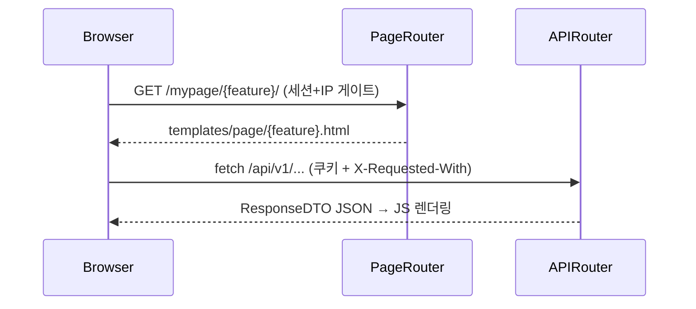

# FastAPI Page Architecture

> 현황 2026-11-07 기준으로 실제 코드에 맞춰 재작성. 이전 판의 범용 템플릿(`interface/pages/admin/*`, `client_page.py`, `/page/{app}/*`, Bootstrap 레이아웃, `APP_COOKIE_NAME`, `/api/v1/auth/token/logout`)은 이 저장소에 존재하지 않음.
> 관련 스킬: API 서버 전체 구조 `fastapi-api-server-structure`.

## 핵심 원칙

1. **Page Router는 GET only** — 템플릿 반환만. CUD는 `src/application/interface/api/*` 재사용 (예외: `/page/recommendations/`는 Redirect).
2. **템플릿은 정적 레이아웃** — 동적 데이터는 페이지 JS가 `/api/v1/*`를 fetch해 렌더링.
3. **컨텍스트 최소 주입** — `active_page`, (필요 시) 설정값, `static_version`(=`settings.app_version`)만.
4. **JS/CSS 분리** — `static/js/pages/{feature}.js`, `static/styles/{feature}.css`, `?v={{ static_version }}` 캐시 버스팅.

## 디렉토리 구조 (실제)

```
src/application/interface/page/
├── __init__.py                 # mypage_routers / public_page_routers / page_routers(하위호환)
├── main_page_router.py         # /mypage
├── admin_login_page_router.py  # /mypage/login (safe_next_path로 next 검증)
├── {feature}_page_router.py    # /mypage/{feature} (backtest, research, ohlcv, holdings, ...)
├── ops_page_router.py          # /ops
└── public_strategy_page_router.py  # /page, /page/scan/, /page/sell-analysis/
templates/
├── layouts/base.html           # 관리자 레이아웃 (+ _sidebar.html, fetch 래퍼)
├── layouts/public_base.html    # 공개 포털 레이아웃 (+ _public_sidebar.html)
└── page/{feature}.html         # 페이지 템플릿 (extends layouts/*)
static/
├── js/pages/{feature}.js       # 마운트: /static/js
└── styles/{feature}.css        # 마운트: /static/styles (mypage.css 공통)
```

- 각 page router는 `APIRouter(prefix="/mypage/{feature}", tags=[...], include_in_schema=False)` + 모듈 로컬 `Jinja2Templates(directory=BASE_DIR/"templates")`, `@router.get("")`/`@router.get("/")` 이중 등록 패턴.

## 등록 규칙 (`page/__init__.py` → `src/main.py`)

- 관리자 페이지: `mypage_routers`에 추가 → `main.py`가 `include_router(r, dependencies=[Depends(verify_admin_access)])`로 일괄 IP 게이트.
- 공개 포털: `public_page_routers`에 추가 → 의존성 없이 등록.
- 사이드바 메뉴: `templates/layouts/_sidebar.html`에 링크 + `active_page` 비교 추가.

## 인증/보안 규칙

| 계층 | 위치 | 동작 |
|------|------|------|
| 로그인 세션 게이트 | `src/application/interface/admin_session_gate.py` `AdminSessionGateMiddleware` | 공개 경로(`/health`, `/page`, `/page/`*, `/static/`*, `/api/v1/public/`*, `/mypage/login`, `/api/v1/admin-auth/login·logout`) 외 전부 세션 요구(fail-closed). 미로그인 GET `/mypage*`·`/ops*` → 303 `/mypage/login/?next=`, API → 401 JSON, WS → close 1008 |
| IP allowlist + CSRF | `src/application/common/dependencies.py` `verify_admin_access` | `admin_allowed_ips` 외 403; POST/PUT/PATCH/DELETE는 `X-Requested-With: XMLHttpRequest` 필수 |
| 주문 API 추가 세션 | `require_admin_session` | `/api/v1/orders`에 라우터 의존성으로 적용 |

- 세션 쿠키: `kis_admin_session`(`ADMIN_SESSION_COOKIE`), 로그인/로그아웃 API: `POST /api/v1/admin-auth/login|logout`, `GET /api/v1/admin-auth/me`.
- JS는 Bearer 토큰을 주입/저장하지 않음(same-origin 쿠키). `layouts/base.html`이 `window.fetch`를 래핑해 `X-Requested-With`를 자동 부착 — 관리자 페이지 JS는 이 레이아웃을 상속해야 쓰기 요청이 403이 안 남.

## 데이터 흐름



## 체크리스트 — 새 관리자 페이지

```
□ page/{feature}_page_router.py (GET only, prefix=/mypage/{feature}, include_in_schema=False)
□ page/__init__.py import + mypage_routers 추가 (+ __all__)
□ templates/page/{feature}.html — , active_page 주입
□ _sidebar.html 메뉴 추가
□ 필요 시 static/js/pages/{feature}.js, static/styles/{feature}.css (?v={{ static_version }})
□ 데이터/CUD는 기존 API 라우터 사용 (새 API면 main.py include_router)
```

공개 페이지는 `public_strategy_page_router.py`에 경로 추가, `layouts/public_base.html` 상속, `/api/v1/public/*`만 호출.

## 금지 사항

| 금지 | 대안 |
|------|------|
| Page Router에서 POST/PUT/DELETE | API Router |
| 템플릿/페이지 라우터에서 DB·KIS 직접 조회 | 도메인 서비스 + API |
| localStorage에 토큰 저장, Bearer 주입 | 세션 쿠키 |
| base.html 우회한 raw fetch 쓰기 요청 | 레이아웃 fetch 래퍼 사용 |
| 공개 포털에서 관리자 API 호출 | `/api/v1/public/*` |
