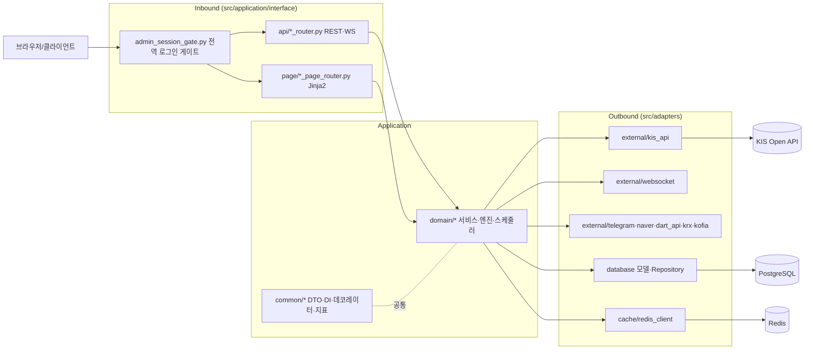

# 증권 전략·알림 서버 아키텍처 - KIS Strategy & Alert Server

## 📋 개요

이 문서는 **한국투자증권 Open API 기반 전략·알림 서비스(KIS Strategy & Alert Server)**의 서버 구조와 구현 규칙을 정의합니다. **헥사고날 아키텍처(Ports & Adapters)**를 기반으로, 국내 주식/ETF 골든크로스 전략 실행·매도 분석·Telegram 알림·운영 대시보드를 제공하는 시스템의 계층별 역할과 데이터 흐름을 설명합니다.

> 사실의 기준은 코드입니다. 세부 규칙은 각 폴더의 `CLAUDE.md`/`AGENTS.md`(예: `src/CLAUDE.md`)에 있고, 이 문서는 요약입니다.

### 🎯 시스템 특징

- **대상 상품**: 국내 주식·ETF(`ETF_UNIVERSE_ENABLED=true`면 ETF 유니버스 221종). 해외/선물옵션/채권 거래 기능은 없음(`examples/`의 KIS 샘플만 존재)
- **실전/모의투자 환경**: `TRADING_ENVIRONMENT`(`prod`/`vps`)로 KIS URL·앱키·계좌·TR ID를 스위칭(`settings.is_paper_trading`)
- **전략 실행**: 골든크로스 FSM(`GoldenCrossEngine` + `GoldenCrossStateMachine`)을 월~금 15:35 스케줄러가 실행. 실주문은 kill-switch `STRATEGY_LIVE_TRADING_ENABLED`(기본 false)로 차단되며, 장후 시간외 종가(`ORD_DVSN 06`) 주문 → 16:10 체결 대사로 확정
- **분석/알림**: 매수 스캔·추천, 매도 점수(Stage 임계 28/49/70), Telegram 알림(슬롯별 on/off)
- **인증**: KIS OAuth 토큰(1일 1회 발급, 파일 캐시 재사용) + 관리자 ID/PW 로그인 세션(Redis)
- **REST + WebSocket + Jinja2 페이지**: `/api/v1/*`, `/ws/*`, `/mypage/*`·`/ops`(관리자), `/page/*`(공개 포털)

---

## 🏛️ 아키텍처 개요

### 헥사고날 아키텍처 (Ports & Adapters Pattern)



- 의존 방향: `interface → domain → adapters`. `settings`·`application/common`은 공통 지원 계층
- 금지: domain에서 FastAPI `Request`/`Response` 사용, interface에서 Repository 직접 호출, adapters에서 정책 결정

---

## 📁 폴더 구조 및 역할

### 전체 구조 (현재 코드)

```text
src/
├── main.py             # FastAPI 앱, lifespan, 미들웨어, 라우터 등록
├── adapters/           # 외부 시스템 연동(순수 I/O)
│   ├── database/       # connection.py, models/, repositories/
│   ├── cache/          # redis_client.py
│   └── external/       # kis_api/, websocket/, telegram/, naver/, dart_api/, krx/, kofia_client.py
├── application/
│   ├── common/         # dto, dependencies, decorators, exceptions, client_ip, password_hash,
│   │                   # indicators, performance_metrics, trading_calendar, middleware/
│   ├── domain/         # access_log, account, admin_auth, auth, backtest, market_data, ohlcv,
│   │                   # order, paper_trade, recommendation, risk, screener, strategy
│   └── interface/      # api/, page/, admin_session_gate.py
└── settings/           # config.py, sell_score_settings.py, logging_config.py, exception_handlers.py

templates/  static/     # Jinja2 템플릿, 페이지 JS/CSS
alembic/                # 비동기 SQLAlchemy 마이그레이션
scripts/                # common/, research/(오프라인 연구), ops/(백필·시딩·관리자 해시)
examples/               # KIS Open API 샘플(examples_llm, examples_user) — 서버 런타임과 무관
reports/                # 연구·walk-forward 리포트(api 컨테이너에 마운트)
```

### 1. Adapters Layer (어댑터 계층)

| 구분 | 역할 | 주요 파일 |
|------|------|----------|
| **KIS API** | 토큰 발급/캐시, REST 호출(레이트리밋·재시도) | `external/kis_api/auth.py`(`KISAuth`), `external/kis_api/client.py`(`KISAPIClient`, `SlidingWindowRateLimiter`) |
| **WebSocket** | KIS 실시간 연결/구독 | `external/websocket/kis_websocket.py`, `websocket_manager.py` |
| **Database** | async SQLAlchemy 모델/Repository | `database/connection.py`, `models/*.py`, `repositories/*_repository.py` |
| **Cache** | Redis 래퍼(세션·캐시·락) | `cache/redis_client.py` |
| **기타 외부** | Telegram 발송, Naver/DART 재무, KRX KIND 목록, KOFIA 신용 | `external/telegram/notifier.py`, `naver/stock_client.py`, `dart_api/client.py`, `krx/kind_client.py`, `kofia_client.py` |

**핵심 모델:** Strategy / StrategySignal / StrategySymbolState, StockUniverse, OHLCV, AnalysisHistory, Order, Account/Position, AccessLog, RecommendationRuleSet, 신용·개인수급 스냅샷

### 2. Application Layer (애플리케이션 계층)

#### 도메인별 구성

| 도메인 | 역할 | 주요 기능 |
|--------|------|----------|
| **auth / admin_auth** | KIS 인증 / 관리자 로그인 | 토큰·승인키 발급 / scrypt 검증, Redis 세션, IP 잠금 |
| **order** | 주문 처리 | 현금 주문(`order-cash`), 조회·취소·정정, 체결 조회(`inquire-daily-ccld`) |
| **account** | 계좌 | 잔고(TTTC8434R `output2`) + 주문가능현금(TTTC8908R `ord_psbl_cash`), 포지션 |
| **market_data / ohlcv** | 시세 / 일봉 캐시 | 현재가·호가·차트 / OHLCV 캐시·워밍업·정리 스케줄러 |
| **strategy** | 전략 | 골든크로스 엔진·FSM·스케줄러, 매수 스캔·추천, 매도 분석, 알림, 유니버스, 시장 국면 게이트 |
| **risk** | 리스크 가드 | `SafetyGuard`(실효: 시장 급락 −2%, 일 신규 진입 3건) |
| **backtest / recommendation** | 검증 | 백테스트·walk-forward·라이브 패리티 리플레이 / 룰셋·후보·검증 |
| **screener / access_log / paper_trade** | 부가 | 가치주 스크리닝 / 접근 로그 / 페이퍼 원장(미배선) |

각 도메인은 대체로 `service.py` + `dto.py` 구성이며, Repository는 `src/adapters/database/repositories/`에 있습니다.

---

## 🔧 핵심 구현 패턴

### 1. BaseRepository + Mixin 패턴
- **구성**: `BaseRepository[Model]`(공통 CRUD) + `SearchableMixin` / `PaginationMixin` / `StatsMixin`(`repositories/base_repository.py`)
- **이점**: 도메인별 특화 메서드만 추가 구현

### 2. 의존성 주입 중앙화 (`common/dependencies.py`)
- `Annotated` 별칭: `DatabaseSession`, `KISClientDep`, `RedisDep`, `KISWebSocketDep`, `SettingsDep`, 서비스 Dep 등
- KIS 인증/클라이언트/WS 팩토리는 `@lru_cache` 싱글톤
- 접근 제어: `AdminAccessDep`(`verify_admin_access`: IP allowlist + 쓰기 메서드 `X-Requested-With`), `AdminSessionDep`/`require_admin_session`, `OptionalAdminSessionDep`

### 3. @transaction 데코레이터 패턴
- 외부 호출 public 메서드에만 적용, `AsyncSessionLocal()`로 세션을 만들어 두 번째 인자로 주입 후 commit/rollback
- 이미 세션이 전달된 내부 호출은 세션 소유권을 호출자에게 둠
- 세션을 소유하는 서비스(`AccessLogService`, `RecommendationRuleSetService`)의 라우터는 세션을 받지 않음

### 4. KIS API Client 관심사 분리
- **인증**: `KISAuth` — 캐시 디렉터리의 `KIS{YYYYMMDD}` 파일 중 유효·최장 만료 토큰 재사용, KST aware 만료, 거부 토큰 제외 후 재발급
- **REST**: `KISAPIClient` — 슬라이딩 윈도우 레이트리밋(운영 `KIS_API_RATE_LIMIT=8`/s), EGW00201 지수 백오프(0.5→1.0→2.0초, 최대 3회)
- **WebSocket**: `KISWebSocket` — 승인키 기반 실시간 구독

### 5. 백그라운드 작업 (`src/main.py` lifespan)

| 작업 | 위치 | 일정(KST) |
|------|------|----------|
| KIS 토큰 확보 + 자동 갱신 | `common/background_tasks.py` | 기동 시(`AUTO_REAUTH`) |
| 유니버스 갱신 / 전략 실행 / 주문 체결 대사 | `domain/strategy/scheduler.py` | 월~금 08:00 / 15:35(misfire 90초) / 16:10 |
| Telegram 알림 | `domain/strategy/notification_scheduler.py` | 매수 11:30·14:30, 매도 09:30·12:30(각 10분 전 갱신, 플래그 꺼지면 미등록) |
| OHLCV 캐시 | `domain/ohlcv/scheduler.py` | 정리 02:00·워밍업 08:00(매일), 증분 16:00(월~금) |

---

## 🔄 주요 API Flow

| 시나리오 | 핵심 단계 | 관련 경로 |
|----------|----------|----------|
| **전략 실행(자동)** | kill-switch → 직전 주문 대사 → MA drift 점검 → 벤치 급락/레짐 게이트 → 후보별 FSM → 시간외 종가 주문 접수(`PENDING`) → 16:10 대사(`EXECUTED`/`CANCELLED`) | 스케줄러, `POST /api/v1/strategies/{id}/execute` |
| **매수 추천/알림** | 유니버스 → 골든크로스 스캔(레짐 fail-open) → 재무 필터 → 스코어 → Top-N → Telegram | `/api/v1/strategies/universe/golden-cross-*`, 알림 스케줄러 |
| **수동 주문** | 로그인 세션 + IP 게이트 → `OrderService.create_order` → KIS `order-cash` | `POST /api/v1/orders` (kill-switch 미적용) |
| **운영 점검** | 헬스(무인증) → 운영 요약 → 스케줄러 상태 | `/health`, `/api/v1/ops/summary`, `/api/v1/ops/notification-scheduler-status`, `/ops` |

---

## 🎯 주요 API 엔드포인트 (현재)

| 도메인 | API | 메서드 | 설명 |
|--------|-----|--------|------|
| **Admin Auth** | `/api/v1/admin-auth/login`, `/logout`, `/me` | POST/POST/GET | 관리자 로그인 세션 |
| **Auth** | `/api/v1/auth/token`, `/token/refresh`, `/token/status` | POST/POST/GET | KIS 토큰 |
|  | `/api/v1/auth/websocket/approval`, `/environment` | POST/GET | 승인키, 거래 환경 조회 |
| **Order** | `/api/v1/orders` | POST/GET | 주문 생성 / 목록 |
|  | `/api/v1/orders/{order_id}` | GET/PATCH | 조회 / 정정 |
|  | `/api/v1/orders/{order_id}/cancel`, `/refresh-status` | POST | 취소 / 체결 상태 갱신 |
| **Account** | `/api/v1/accounts/balance`, `/positions` | GET | 잔고 / 포지션 |
| **MarketData** | `/api/v1/market/price/{symbol}`, `/orderbook/{symbol}`, `/chart/{symbol}` | GET | 현재가 / 호가 / 차트 |
| **Strategy** | `/api/v1/strategies/{id}/execute` | POST | 전략 실행(dry-run 기본) |
|  | `/api/v1/strategies/scheduler/status`, `/universe/*`, `/sell-signal/{symbol}`, `/analysis-history*`, `/portfolio-cash-plan` | GET 등 | 스케줄러·유니버스·매도 분석·이력·현금화 계획 |
| **Public** | `/api/v1/public/strategies/*` | GET/POST | 공개 제한형 스캔·매도 분석·추천 스냅샷 |
| **기타** | `/api/v1/ops/*`, `/api/v1/backtest/*`, `/api/v1/recommendations/*`, `/api/v1/screener/*`, `/api/v1/access-logs*` | — | 운영·백테스트(raw DTO)·추천 룰셋·스크리너·접근 로그 |
| **WebSocket** | `/ws/realtime` (WS), `/ws/info` (GET) | — | 실시간 시세 |

`strategy_router.admin_router` 경로 — 전략 생성/수정/삭제(`POST /api/v1/strategies`, `PATCH`/`DELETE /api/v1/strategies/{id}`), 알림 수동 실행(`/scheduler/notifications/{buy,sell}/execute`), 신용·개인수급 캐시 갱신/백필 — 는 `ENABLE_ADMIN_STRATEGY_ROUTES=true`일 때만 마운트됩니다(기본 미마운트).

---

## 🔒 보안 및 최적화

### 보안 처리
- **전역 로그인 게이트**: `AdminSessionGateMiddleware`가 `/page*`, `/static/*`, `/api/v1/public/*`, `/mypage/login`, `/api/v1/admin-auth/{login,logout}`, `/health` 외 전 경로(HTTP·WS)에 세션 요구. 쿠키 `kis_admin_session`(HttpOnly, SameSite=Strict, 운영 Secure), IP별 5회 실패 시 잠금
- **IP allowlist**: `ADMIN_ALLOWED_IPS`(현재 운영은 전 대역) + 쓰기 메서드 CSRF 헤더; 클라이언트 IP는 `common/client_ip.py` 단일 출처, 프록시 헤더는 `TRUSTED_PROXY_IPS`(운영: kis-network 게이트웨이 `172.18.0.1` 포함)에서만 신뢰
- **배포 경계**: 외부는 `https://stock.lgetech.co.kr`(nginx-proxy)만, api는 `127.0.0.1:10131` 바인딩. Swagger/ReDoc/OpenAPI 비활성
- **실주문 차단**: 전략 경로는 `STRATEGY_LIVE_TRADING_ENABLED`(기본 false) — `POST /api/v1/orders`는 이 스위치를 거치지 않음
- **비밀**: `.env`(커밋 금지), 토큰 캐시는 `kis_token_cache` 볼륨(0600 파일)

### 성능 최적화
- **Redis 캐싱(설정 기본값)**: 시세 5초, 호가 스냅샷 15초, 일봉 86400초, 분봉 900초, 계좌 30초
- **OHLCV DB 캐시**: 15:31 KST 전 당일 일봉은 저장하지 않음(잠정 봉 가드), 보존 `OHLCV_RETENTION_DAYS`=3650
- **Connection Pool**: SQLAlchemy async `pool_size=10`, `max_overflow=20`, `pool_pre_ping`; httpx `AsyncClient` 재사용
- **비동기 처리**: asyncio 기반, 스캔 동시성 `SCAN_CONCURRENCY_LIMIT`(기본 5)

### 자동매매 특화 규칙
- **중복 주문 방지**: `order_no`가 있으면 `CANCELLED`가 아닌 한 재주문 금지(매도 일부 체결 잔량만 재매도 허용)
- **리스크 관리**: 시장 국면 게이트(ADX14≥20, 실주문 fail-closed, 신규 매수만 차단), 시장 급락 가드(−2%), 일 신규 진입 3건, 최대 보유 = 전략 config `max_position_count`(5)
- **사이징**: 주문가능현금 × `allocation_ratio`

---

## 📊 KIS 샘플 코드 현황 (`examples/`)

서버 런타임과 별개로, KIS Open API 호출 샘플이 `examples/`에 있습니다(명명 규칙은 `docs/base/convention.md`).

| 디렉터리 | 내용 |
|---------|------|
| `examples/examples_llm/{auth,domestic_stock,overseas_stock,etfetn}/` | API 단위 한줄호출함수(`<api>.py`) + 체크함수(`chk_<api>.py`) |
| `examples/examples_user/{auth,domestic_stock,overseas_stock,etfetn}/` | 카테고리별 통합 함수/예제(`*_functions.py`, `*_examples.py`, `*_ws.py`) |
| `examples/backtest/` | 골든크로스 백테스트·MA 최적화·walk-forward 설정 예시 |

---

## 📚 관련 문서

- [서비스 구현 가이드](/docs/base/SERVICE.md)
- [코딩 컨벤션](/docs/base/convention.md)
- [프로젝트 README](/README.md)
- 레이어별 상세: `src/CLAUDE.md`, `src/**/CLAUDE.md`, `src/**/AGENTS.md`
- [한국투자증권 Open API 포털](https://apiportal.koreainvestment.com/)

---

## 📞 문서 정보

- **프로젝트**: KIS Strategy & Alert Server
- **문서 위치**: `/docs/base/ARCHITECTURE.md`
- **최종 업데이트**: 2026년 11월 7일 (코드 기준 재동기화)
- **문서 버전**: 2.0 (초기 설계안 1.0을 현재 구현 기준으로 교체)

---

**💡 중요**: 이 서비스는 **헥사고날 아키텍처**로 외부 시스템과의 결합도를 낮추고 테스트 가능성을 유지합니다. 실주문 경로는 kill-switch·로그인 게이트·체결 대사로 보호되지만, 현재 골든크로스 전략은 연구 결론 NO-GO로 `paused` 상태입니다.
