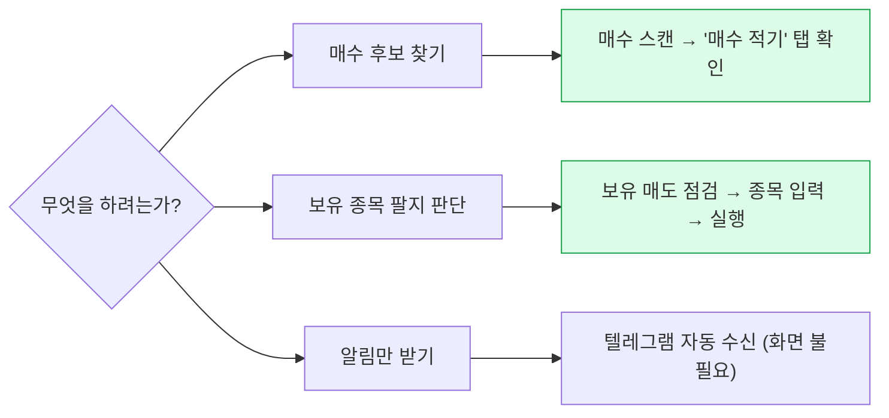
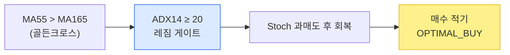

# 매수/매도 전략 사용 가이드 (mypage 기준)

> 대상: 운영자 · 최종 갱신 2026-11-07 (코드 대조 감사)
> 이 문서는 **현행 코드 실측 기반**입니다. 계획/과거 문서는 `docs/archive/` 참고.

---

## 0. 핵심 요약 — 먼저 이것만

- **라이브 매수 전략은 골든크로스 하나뿐입니다.** 고를 것이 없습니다. (MA5 돌파·MA 변형은 제거됨)
- ⚠️ **현재 전략은 실자금 NO-GO 판정 + 일시정지 상태입니다.** `STRATEGY_LIVE_TRADING_ENABLED=false`(kill switch), 라이브 전략 status=paused. 근거는 §6.
- **매도는 점수 기반 4단계**로 자동 산출됩니다.
- **매수 스캔·매도 알림은 스케줄러가 자동 실행**합니다. mypage 화면은 대부분 *검토·수동 확인용*입니다.
- ⚠️ **실주문으로 이어지는 유일한 조작은 `내 전략` 화면의 프리셋 활성화**뿐입니다. 나머지 버튼은 주문을 내지 않습니다.
- ⚠️ **매도 판단 엔진은 3벌(E1/E2/E3)이고 서로 규칙이 다릅니다.** 각 화면 상단의 엔진 배지로 출처를 확인하세요. E1=실주문(월~금 15:35, `STRATEGY_LIVE_TRADING_ENABLED`가 켜진 경우에만), E2=화면·API·텔레그램 분석, E3=백테스트. 상세는 [`docs/sell-strategy.md`](sell-strategy.md) §1.



---

## 1. 하루 자동 실행 타임라인 (평일 KST)

| 시각 | 주체 | 동작 |
|------|------|------|
| 08:00 | StrategyScheduler | 유니버스 갱신 |
| 09:20 → 09:30 | NotificationScheduler | 매도 리스크 갱신 → 매도 알림 |
| 11:30 / 14:30 | NotificationScheduler | 매수 스캔 → 매수 알림 |
| 12:20 → 12:30 | NotificationScheduler | 매도 리스크 갱신 → 매도 알림 |
| **15:35** | StrategyScheduler | **활성 골든크로스 전략 실주문 실행 (`dry_run=False`)** — 당일 종가 봉 조회 후 장후 시간외 종가 주문(`STRATEGY_ORDER_PRICE_TYPE=closing`, ORD_DVSN 06, 접수 15:30~16:00·체결 15:40~16:00). 시그널은 `PENDING`+order_no |
| 16:00 | OHLCVScheduler | 일봉 증분 업데이트 |
| **16:10** | StrategyScheduler | `daily_order_reconcile` — PENDING 주문 체결조회 → `EXECUTED`(실체결가·수량, 비용 반영 손익, 국내 ETF 거래세 면제) 또는 `CANCELLED` |

> ⚠️ 15:35 실주문은 활성 전략이 있고 `STRATEGY_LIVE_TRADING_ENABLED=true`일 때만 발생합니다. 마스터 스위치 기본값은 `false`이며 검증 전에는 변경하지 않습니다.
> 알림 슬롯(09:30/12:30 매도, 11:30/14:30 매수)은 각각 `SELL_NOTIFICATION_ENABLED`(기본 OFF) / `BUY_NOTIFICATION_ENABLED`(기본 ON)와 `TELEGRAM_ENABLED`에 따라 발송됩니다.

---

## 2. mypage 화면 지도

```
운영    Dashboard · Operations · Access Logs
전략    전략 센터 · Sell Strategy · 보유 매도 점검 · Backtest · 전략 연구
데이터  WebSocket   (OHLCV Cache 페이지는 백엔드 API가 없어 2026-11-07 제거)
수동/고급(자동화로 대체됨)  Auth · Account · Order · Market Data
```

| 화면 | URL | 용도 | 엔진(화면 배지) | 실주문? |
|------|-----|------|------|:-------:|
| 전략 센터 | `/mypage/strategy-hub` | 매수 스캔·추천·내전략 3탭 허브 | — (배지 없음) | — |
| └ 매수 스캔 | `/mypage/strategy` | 골든크로스 스캔·재무필터 | — (배지 없음) | ✕ |
| └ 추천/룰셋 | `/mypage/recommendation` | 후보 추천·walk-forward | `실주문 엔진 E1 측정` (walk-forward 검증 카드) | ✕ |
| └ 내 전략 | `/mypage/strategy/dashboard` | 프리셋 **활성화** | `실주문 엔진 E1` + `실주문 스위치 ON/OFF` | ⚠️ **O** (스위치 OFF면 15:35 실행이 kill-switch로 차단) |
| Sell Strategy | `/mypage/sell-strategy` | 매도 시그널·현금화 계획 | 종목분석·현금화 = `분석 엔진 E2` / 백테스트 탭 = `백테스트 엔진 E3` / walk-forward 탭 = `실주문 엔진 E1 측정` | ✕ |
| 보유 매도 점검 | `/mypage/holdings` | 보유종목 매도 판단 | `분석 엔진 E2` | ✕ |
| Backtest | `/mypage/backtest` | 백테스트 검증 | `백테스트 엔진 E3` | ✕ |

mypage 밖의 매도 표시 경로:

| 표시 경로 | 위치 | 엔진(배지) |
|------|------|------|
| 운영 대시보드 — 매도 감시 카드 | `/ops` | `분석 엔진 E2` |
| 텔레그램 매도 알림 (09:30/12:30) | Telegram | 헤더 1줄 `ℹ️ 분석 엔진 E2 · 참고용 분석이며 자동 주문은 나가지 않습니다` |
| 공개 매도 분석 | `/page/sell-analysis/` | `분석 엔진 E2` |
| 공개 전략 소개 — 매도 절 | `/page/` | `분석 엔진 E2` |

> 위에 열거한 화면·알림에만 엔진 배지가 있습니다(전략 센터·매수 스캔에는 없습니다).
> **E2 화면에서 본 EXIT_ALL이 15:35에 그대로 주문되지 않습니다.** 실주문은 E1이 별도 규칙으로 판단합니다.

---

## 3. 매수(BUY) — 골든크로스

### 3.1 전략 로직



- **핵심 조건**: `MA55 > MA165` 활성 + Stochastic 풀백 후 회복. MA 기간은 `GC_SHORT_MA_PERIOD`/`GC_LONG_MA_PERIOD`(기본·운영 `.env`·라이브 전략 config 모두 55/165). 라이브 엔진은 전략 config와 설정값이 다르면 `MA drift` 에러 로그를 남깁니다.
- **진입 레짐 게이트 (운영 ON)**: `ADX14 ≥ 20` — 추세 강도가 있는 국면에서만 신규 진입(횡보장 잠식 회피). 벤치 `069500`(KODEX200) 실 OHLC 사용. 운영 `.env`에서 `GC_REGIME_FILTER_ENABLED=true`, `GC_REGIME_MODE=adx`(코드 기본값은 OFF). 벤치 데이터가 없거나 7일 넘게 stale이면 **스캔·알림은 fail-open(후보 유지), 실주문 엔진은 fail-closed(신규 매수만 차단, 청산 무관)**.
- **실주문 추가 가드(E1)**: 벤치 당일 −2% 이하 급락 시 신규 매수 차단, 일 신규 진입 3건 상한, 최대 보유 종목 수 = 전략 config(기본 5). 손실 한도·연속 손실 가드는 현재 실효 없음.
- **유니버스**: ETF 모드(`ETF_UNIVERSE_ENABLED=true`)에서는 스캔·실주문 모두 활성 ETF 전체(221종)가 대상입니다(시총·거래량 스크리닝 미적용).
- **부속 옵션**: RSI 과매도 게이트(≤40, 기본 OFF) · Fear-buy 공포윈도우(기본 ON)
- **상태 6단계**: `OPTIMAL_BUY > BUY_INTEREST > READY_TO_BUY > WAITING_FOR_PULLBACK > GC_ACTIVE > NOT_GC`

### 3.2 매수 스캔 사용법 (`/mypage/strategy`)

버튼을 **위→아래 순서**로 누르면 됩니다:

1. `유니버스 갱신` — (보통 08:00 자동, 수동 불필요)
2. `골든크로스 스캔` — 후보 산출
3. `재무 필터 (2차)` — DART 재무로 걸러내기 (ETF 모드면 생략)
4. 결과 탭에서 **`매수 적기(OPTIMAL_BUY)`** 확인 ← **가장 강한 후보**

→ 여기까지 전부 **읽기 전용**. 실주문 안 나감.

### 3.3 관련 엔드포인트

```
GET  /api/v1/strategies/universe/golden-cross-scan
GET  /api/v1/strategies/universe/golden-cross-recommendations
POST /api/v1/strategies/universe/golden-cross-recommendations/notify   # + 텔레그램
POST /api/v1/strategies/universe/golden-cross-scan-symbols             # 지정 심볼
POST /api/v1/strategies/universe/financial-filter
```

---

## 4. 매도(SELL) — 점수 기반 4단계

### 4.1 점수 규칙과 단계

12개 규칙 점수를 합산 → 100점 정규화 → 단계 판정:

| 정규화 점수 | 단계 | 청산 비율 |
|:-----------:|------|:---------:|
| **≥ 70** | EXIT_ALL | 전량 (100%) |
| **≥ 49** | REDUCE_2 | 30~40% |
| **≥ 28** | REDUCE_1 | 20~30% |
| < 28 | HOLD | — |

> 청산 비율은 종목 단위 분석값(`dto.SELL_STAGE_RATIOS`)이다. 포트폴리오 현금화 계획은 별도 기본값(`dto.CASH_PLAN_BASE_SELL_RATIOS`: REDUCE_1 25% / REDUCE_2 50% / EXIT_ALL 100%)을 쓰므로 두 숫자가 달라도 정상이다.
>
> 임계값의 단일 출처는 `src/settings/sell_score_settings.py`(`SellScoreSettings`, env `SELL_SCORE_*`)다. 2026-11-06 정규화 분모 수정 후 **기존 Stage 발생 빈도를 보존하도록** 30/50/70 → 28/49/70으로 재보정했다. 수익 검증값이 아니며, 같은 재생에서 점수와 20일 선행수익률은 양(+)의 관계였다(높은 점수 = 매도 신호로서 근거 없음).

주요 규칙(가중치): Stoch 30 · RSI 25 · Volume 20 · ADX 15 · 개인수급 12 · MA 10 · 데드크로스 10 · 신용 8 · risk_combo 6 · ADX강세 페널티(감점)

### 4.2 매도 판단 사용법

| 목적 | 화면 → 조작 |
|------|-------------|
| **내 보유 전체 점검** | `보유 매도 점검` → 종목 입력 → `매도 점검 실행` → REDUCE/EXIT만 대응 |
| 개별 종목 판단 | `Sell Strategy` → 종목코드 → `매도 시그널 분석` (보유 매도 점검은 `highest_price`도 받아 최종 단계 `final_stage`로 표시) |
| 목표 현금비중 청산계획 | `Sell Strategy` → `현금화 계획 갱신` (`target_cash_ratio`) |

### 4.3 관련 엔드포인트

```
GET /api/v1/strategies/sell-signal/{symbol}   # entry_price·highest_price·strategy_id(트레일링 거리=전략 risk_config, 기본 7%)
GET /api/v1/strategies/portfolio-cash-plan?target_cash_ratio=0.30
```

---

## 5. 실전 루틴 (이대로만)

1. **매수 후보** → `매수 스캔`의 "매수 적기" 탭 확인 → 관심종목 메모
2. **매도 판단** → `보유 매도 점검`에 보유종목 입력 → 실행 → REDUCE/EXIT 대응
3. **알림** → 텔레그램 자동 수신(매수 11:30·14:30 / 매도 09:30·12:30) — 화면 안 켜도 됨

---

## 6. ⚠️ 반드시 지킬 것

1. **`내 전략` 프리셋 활성화 금지** — 검증되지 않은 전략에 15:35 실주문이 나갑니다.
2. **골든크로스는 실측상 NO-GO (약 88% 확신)** — 2026-11-06 연구(`reports/research_2026-11-06_summary.md`): 모든 GC 변형이 노출 매칭 B&H 대비 −9~−26%p, DSR < 0.01. ETF 모멘텀 top5는 GC보다 낫지만 B&H 미달·MDD −51%. **실자산 엣지가 확인된 것이 아닙니다** → 실주문 금지, 진행하더라도 dry-run 운영 검증 단계로만 취급.
3. **ADX 게이트는 벤치 데이터에 의존** — `069500` 일봉이 7일 넘게 밀리면 스캔은 fail-open(게이트 무효), 실주문은 fail-closed(신규 매수 전면 차단)가 됩니다. 데이터 신선도 = 필터 작동 여부. (2026-11-06 이전에는 라이브/스캔 ADX 판정이 항상 오류로 fail-open되던 버그가 있었음 — 수정됨)
4. **매도 Stage 임계값(28/49/70)은 수익 검증값이 아닙니다** — §4.1 주석 참고.

### 근거 문서
- 최신 연구 판정: `reports/research_2026-11-06_summary.md`, `docs/plans/state-overlay-result.md`, `docs/plans/leverage-overlay-result.md`
- 백테스트 결과: `docs/backtesting/PERFORMANCE_TEST_RESULTS.md`, `reports/walk_forward_*`
- 레짐 A/B: `reports/walk_forward_regime_ab_20260802_*`
- 완료된 계획 이력: `docs/archive/`
